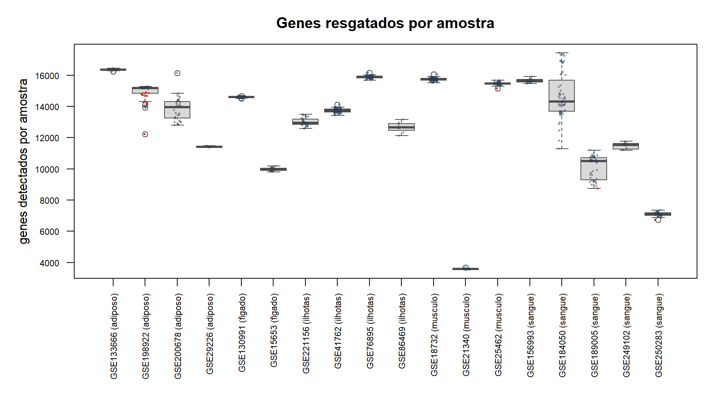
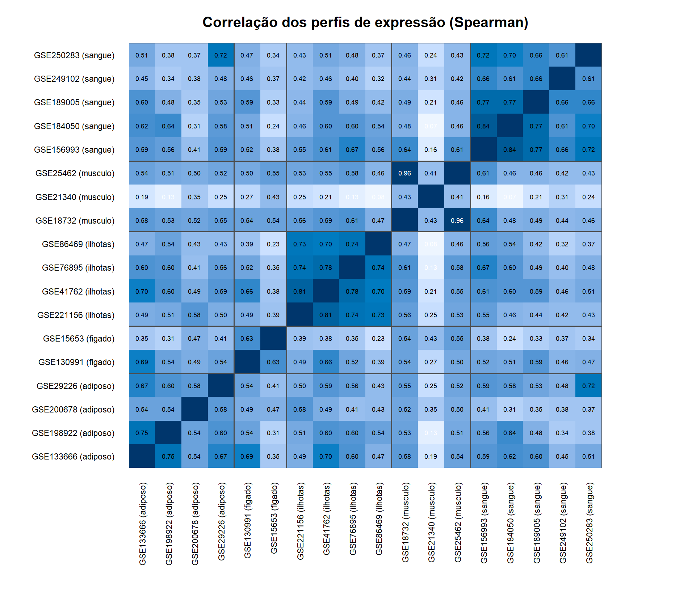
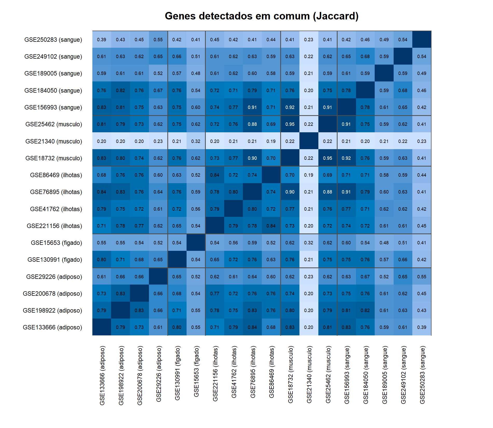
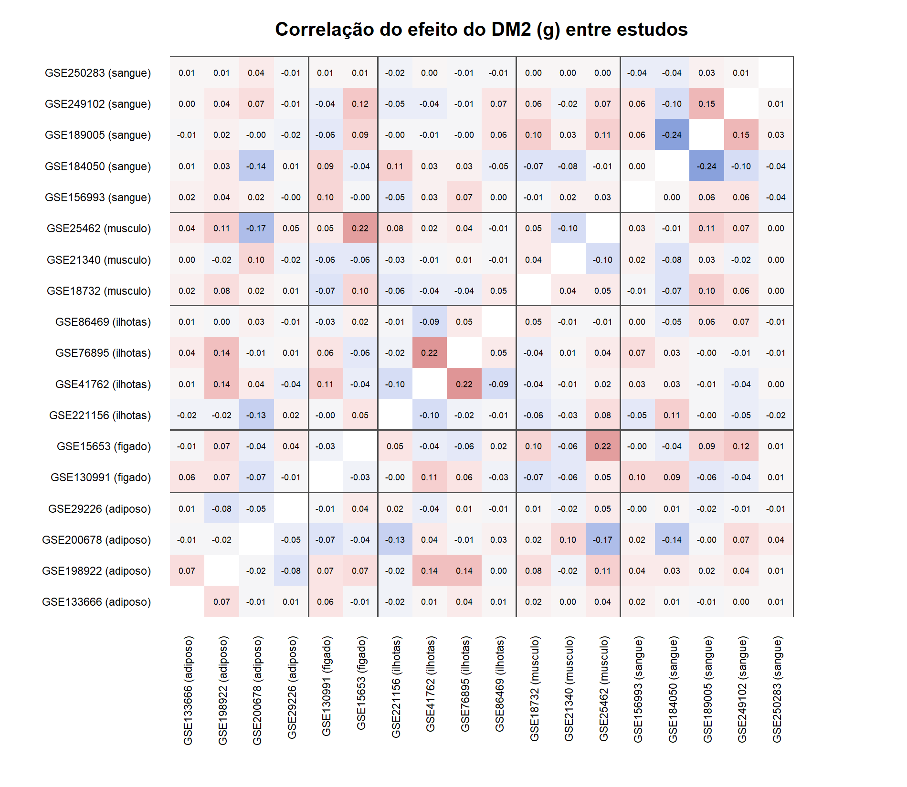

# Testes de sanidade e comparabilidade dos dados

Gerado em 12/10/2026 13:10 a partir de `output/` (sanidade completa). Verificações: 1449; OK 1442; ALERTA 7; ERRO 0.

| etapa | OK | ALERTA | ERRO |
|---|---|---|---|
| 02 |  20 | 0 | 0 |
| 04 | 289 | 0 | 0 |
| 05 | 756 | 2 | 0 |
| 06 | 169 | 0 | 0 |
| 07 |  14 | 0 | 0 |
| 08 |  13 | 0 | 0 |
| 09 | 110 | 0 | 0 |
| 10 |  53 | 0 | 0 |
| comparabilidade |   2 | 4 | 0 |
| config |  10 | 0 | 0 |
| confusao |   0 | 1 | 0 |
| controles |   4 | 0 | 0 |
| execucao |   2 | 0 | 0 |

## Problemas (ERRO = resultado não confiável; ALERTA = conferir)

| Gravidade | Etapa | Arquivo | Regra | Ocorrências | Exemplo |
|---|---|---|---|---|---|
| ALERTA | 05 | estudos.csv | estudos com alerta de sanidade (sinal fora do esperado) |  4 | GSE130991 0.138; GSE221156 0.206; GSE18732 0.112; GSE189005 0.247 |
| ALERTA | 05 | conjuntos de genes aleatórios | escore de via sem viés: conjuntos aleatórios com p < 0,05 <= 0.15 |  1 | GSE221156 0.19 |
| ALERTA | comparabilidade | estudos | estudo mais parecido (perfil) é do mesmo tecido |  4 | GSE200678 ~ GSE221156; GSE29226 ~ GSE250283; GSE130991 ~ GSE133666; GSE250283 ~ GSE29226 |
| ALERTA | comparabilidade | estudos | genes medidos em comum entre estudos do mesmo tecido (Jaccard >= 0.5) |  2 | GSE18732 GSE21340 0.302; GSE25462 GSE21340 0.302 |
| ALERTA | comparabilidade | amostras | amostras com poucos genes detectados (< mediana - 3 MAD do estudo) | 17 | GSE198922 1_PRE; GSE198922 15_PRE; GSE198922 3_PRE; GSE198922 30_PRE; GSE198922 31_PRE; GSE198922 33_PRE; GSE198922 35_PRE; GSE198922 4_PRE; GSE198922 |
| ALERTA | comparabilidade | estudos | símbolos antigos (aliases) perdidos > 2% dos genes |  5 | GSE29226 0.0572; GSE130991 0.0717; GSE184050 0.061; GSE250283 0.0864; GSE249102 0.1217 |
| ALERTA | confusao | mulheres 40-60 | variáveis desbalanceadas entre DM2 e ND (/SMD/ > 0.8) | 29 | GSE200678 comp_adipocito 1.3; GSE200678 comp_endotelio 1.14; GSE133666 idade 3.91; GSE198922 comp_adipocito -2.75; GSE198922 comp_imune 1.38; GSE29226 |

## Decisões do usuário sobre alertas

- **marcadores de outro tecido** (GSE198922:11_PRE, GSE198922:4_PRE, GSE198922:46_PRE): Mantidas (usuário, 08/10/2026): possível contaminação por músculo na biópsia de adiposo; ficam para não perder N. Nenhuma está no modelo principal (2 homens e 1 mulher fora de 40-60): entram só na rede (etapa 06) e na sensibilidade com todas as amostras.
- **doador duplicado** (GSE29226:ND2, GSE29226:ND3): Não são a mesma pessoa (usuário, 08/10/2026): idades diferentes (65 e 60 anos). Perfis muito parecidos provavelmente por lote e pelo pequeno número de amostras do estudo (6).

### Amostras com marcadores de outro tecido

| gse | coluna | individuo | sexo | status | mulher_40a60 | tecido | tecido_por_marcadores | decisao |
|---|---|---|---|---|---|---|---|---|
| GSE198922 | 11_PRE | GSE198922:11 | M | T2D | FALSE | adiposo | musculo | mantida por decisão do usuário (possível contaminação) |
| GSE198922 | 4_PRE | GSE198922:4 | M | T2D | FALSE | adiposo | musculo | mantida por decisão do usuário (possível contaminação) |
| GSE198922 | 46_PRE | GSE198922:46 | F | T2D | FALSE | adiposo | musculo | mantida por decisão do usuário (possível contaminação) |

### Pares de amostras com perfil quase idêntico

| estudo_a | amostra_a | estudo_b | amostra_b | r | individuo_a | individuo_b | idade_a | idade_b | conclusao |
|---|---|---|---|---|---|---|---|---|---|
| GSE29226 | GSE29226:ND2 | GSE29226 | GSE29226:ND3 | 0.95 | GSE29226:ND2 | GSE29226:ND3 | 65 | 60 | idade ou sexo diferentes: não é a mesma pessoa |

## Comparabilidade dos dados

- Genes medidos por estudo: 5281 a 17934 (codificantes); genes detectados por amostra: mediana de 3575 a 16363 entre os estudos.
- Perfil de expressão: correlação média dentro do tecido 0.60 a 0.75; entre tecidos 0.39 a 0.53. Dentro > entre indica que os estudos de um tecido são comparáveis entre si.
- Efeito do DM2: correlação média dos g dentro do tecido adiposo -0.01, figado -0.03, ilhotas 0.01, musculo -0.00, sangue -0.01; entre tecidos 0.00 a 0.03. Perto de 0 = os estudos não concordam no sinal do DM2 gene a gene (esperado com N pequeno e muita confusão em humanos).
- Concordância de sentido entre genes com p < 0,05 nos dois estudos (acaso = 0,50): dentro do tecido adiposo 0.49, figado 0.35, ilhotas 0.56, musculo 0.67, sangue 0.55; entre tecidos 0.48 a 0.59.
- Cobertura: genes medidos em todos os estudos do tecido / em algum: adiposo 51%, figado 62%, ilhotas 69%, musculo 30%, sangue 64%.
- Permutação dos rótulos: fração de p < 0,05 sob o acaso, média 0.050 (esperado ~0,05). Estudos com sinal do DM2 acima do acaso (p empírico < 0,05): GSE130991.

### Genes resgatados por estudo

| gse | tecido | tipo | uso | amostras | mulheres_40a60_modelo | genes_brutos | genes_medidos | genes_analisados_05 | genes_detectados_estudo | mediana_detectados_amostra | min_detectados_amostra | amostras_baixa_deteccao |
|---|---|---|---|---|---|---|---|---|---|---|---|---|
| GSE200678 | adiposo | contagens | principal |  31 |   6 | 13060 | 12826 | 13351 | 13758 | 13958.0 | 12796 |  0 |
| GSE133666 | adiposo | cel | principal |  17 |   7 | 26021 | 17864 | 17864 | 16377 | 16363.0 | 16229 |  0 |
| GSE198922 | adiposo | contagens_norm | principal |  46 |   8 | 18422 | 15316 | 15250 | 15280 | 15189.5 | 12239 | 13 |
| GSE29226 | adiposo | illumina_bruto | principal |   6 |   4 | 37804 | 14975 | 14975 | 11548 | 11418.0 | 11370 |  0 |
| GSE130991 | figado | series_matrix | principal | 564 | 204 | 22615 | 16149 | 16149 | 14597 | 14600.0 | 14520 |  1 |
| GSE41762 | ilhotas | cel | principal |  75 |  18 | 18866 | 17357 | 17357 | 13776 | 13732.0 | 13427 |  0 |
| GSE221156 | ilhotas | pseudobulk_h5ad | principal |  34 |   6 | 18990 | 14990 | 15315 | 13050 | 12942.0 | 12578 |  0 |
| GSE76895 | ilhotas | cel | principal |  66 |   8 | 20826 | 17312 | 17312 | 15919 | 15882.5 | 15682 |  0 |
| GSE86469 | ilhotas | pseudobulk_csv | principal |   8 |   4 | 15726 | 14843 | 14628 | 12874 | 12663.5 | 12140 |  0 |
| GSE18732 | musculo | cel | principal |  91 |  22 | 20826 | 17312 | 17312 | 15756 | 15752.0 | 15518 |  0 |
| GSE25462 | musculo | cel | principal |  48 |  11 | 20826 | 17312 | 17312 | 15511 | 15471.5 | 15165 |  1 |
| GSE184050 | sangue | contagens_norm | principal |  56 |  28 | 24737 | 17610 | 14933 | 14543 | 14318.5 | 11302 |  0 |
| GSE250283 | sangue | illumina_bruto | principal |  35 |  12 | 33051 | 13629 | 13629 |  6877 |  7115.0 |  6733 |  1 |
| GSE249102 | sangue | agilent_bruto | principal |   8 |   4 | 22682 | 16174 | 16153 | 11549 | 11532.5 | 11192 |  0 |
| GSE21340 | musculo | cel | só sensibilidade (lote confundido) |  15 |   8 |  5369 |  5281 |  5281 |  3564 |  3575.0 |  3533 |  0 |
| GSE189005 | sangue | cel | só sensibilidade (lote confundido) |  44 |  10 | 24126 | 17934 | 17934 | 10398 | 10493.0 |  8744 |  1 |
| GSE15653 | figado | cel | replicação (fígado em dois níveis) |  18 |   7 | 12650 | 12226 | 12226 |  9984 |  9955.5 |  9791 |  0 |
| GSE156993 | sangue | cel | só sensibilidade (contraste não isola o DM2) |  16 |   9 | 20826 | 17312 | 17311 | 15790 | 15633.5 | 15467 |  0 |

### Similaridade dentro e entre tecidos

| comparacao | tipo | pares | jaccard_medidos | jaccard_detectados | cor_perfil | cor_efeito_dm2 | concordancia_sentido_p05 |
|---|---|---|---|---|---|---|---|
| adiposo | dentro do tecido |  6 | 0.709 | 0.713 | 0.613 | -0.014 | 0.486 |
| figado | dentro do tecido |  1 | 0.620 | 0.537 | 0.631 | -0.029 | 0.346 |
| ilhotas | dentro do tecido |  6 | 0.818 | 0.779 | 0.750 |  0.007 | 0.561 |
| musculo | dentro do tecido |  3 | 0.535 | 0.464 | 0.601 | -0.005 | 0.666 |
| sangue | dentro do tecido | 10 | 0.818 | 0.580 | 0.700 | -0.011 | 0.548 |
| adiposo x figado | entre tecidos |  8 | 0.690 | 0.625 | 0.475 |  0.014 | 0.486 |
| adiposo x ilhotas | entre tecidos | 16 | 0.773 | 0.726 | 0.531 |  0.013 | 0.487 |
| adiposo x musculo | entre tecidos | 12 | 0.627 | 0.564 | 0.431 |  0.018 | 0.514 |
| adiposo x sangue | entre tecidos | 20 | 0.764 | 0.635 | 0.495 |  0.006 | 0.505 |
| figado x ilhotas | entre tecidos |  8 | 0.712 | 0.622 | 0.427 |  0.014 | 0.532 |
| figado x musculo | entre tecidos |  6 | 0.626 | 0.545 | 0.473 |  0.029 | 0.557 |
| figado x sangue | entre tecidos | 10 | 0.744 | 0.571 | 0.420 |  0.028 | 0.594 |
| ilhotas x musculo | entre tecidos | 12 | 0.681 | 0.581 | 0.419 |  0.001 | 0.527 |
| ilhotas x sangue | entre tecidos | 20 | 0.788 | 0.633 | 0.496 |  0.007 | 0.478 |
| musculo x sangue | entre tecidos | 15 | 0.670 | 0.511 | 0.393 |  0.016 | 0.574 |

| tecido | estudos | genes_em_algum | genes_em_todos | frac_em_todos |
|---|---|---|---|---|
| adiposo | 4 | 18998 |  9701 | 0.511 |
| figado | 2 | 17518 | 10857 | 0.620 |
| ilhotas | 4 | 18668 | 12957 | 0.694 |
| musculo | 3 | 17347 |  5246 | 0.302 |
| sangue | 5 | 18973 | 12216 | 0.644 |

### Identidade do tecido (percentil médio dos marcadores)

| gse | tecido | metodo_deteccao | ilhotas | figado | adiposo | musculo | sangue |
|---|---|---|---|---|---|---|---|
| GSE200678 | adiposo | CPM >= 1 | NA | 0.402 | 0.975 | NA | 0.615 |
| GSE133666 | adiposo | acima do fundo dos genes do Y nas mulheres (2.93) | 0.078 | 0.439 | 0.976 | 0.330 | 0.655 |
| GSE198922 | adiposo | acima do fundo dos genes do Y nas mulheres (0.09) | NA | 0.174 | 0.955 | 0.301 | 0.666 |
| GSE29226 | adiposo | acima do fundo dos genes do Y nas mulheres (4.49) | 0.167 | 0.372 | 0.955 | 0.262 | 0.718 |
| GSE130991 | figado | acima do fundo dos genes do Y nas mulheres (3.07) | 0.206 | 0.995 | 0.358 | 0.379 | 0.654 |
| GSE41762 | ilhotas | acima do fundo dos genes do Y nas mulheres (5.00) | 0.989 | 0.427 | 0.210 | 0.299 | 0.342 |
| GSE221156 | ilhotas | CPM >= 1 | 0.994 | 0.307 | NA | 0.101 | 0.415 |
| GSE76895 | ilhotas | acima do fundo dos genes do Y nas mulheres (3.49) | 0.990 | 0.368 | 0.223 | 0.167 | 0.348 |
| GSE86469 | ilhotas | CPM >= 1 | 0.953 | 0.292 | 0.159 | NA | 0.432 |
| GSE18732 | musculo | acima do fundo dos genes do Y nas mulheres (4.02) | 0.137 | 0.310 | 0.411 | 0.997 | 0.467 |
| GSE25462 | musculo | acima do fundo dos genes do Y nas mulheres (4.11) | 0.114 | 0.284 | 0.485 | 0.996 | 0.488 |
| GSE184050 | sangue | acima do fundo dos genes do Y nas mulheres (1.09) | 0.103 | 0.234 | 0.158 | 0.194 | 0.900 |
| GSE250283 | sangue | acima do fundo dos genes do Y nas mulheres (4.70) | 0.259 | 0.403 | 0.507 | 0.220 | 0.881 |
| GSE249102 | sangue | acima do fundo dos genes do Y nas mulheres (4.11) | 0.469 | 0.270 | 0.325 | 0.328 | 0.940 |
| GSE21340 | musculo | acima do fundo dos genes do Y nas mulheres (6.30) | 0.590 | 0.450 | 0.448 | 0.995 | 0.507 |
| GSE189005 | sangue | acima do fundo dos genes do Y nas mulheres (4.37) | 0.158 | 0.286 | 0.229 | 0.393 | 0.995 |
| GSE15653 | figado | acima do fundo dos genes do Y nas mulheres (4.85) | 0.172 | 0.999 | 0.381 | 0.216 | 0.677 |
| GSE156993 | sangue | acima do fundo dos genes do Y nas mulheres (0.52) | 0.104 | 0.244 | 0.229 | 0.172 | 0.891 |

### Nulos: permutação dos rótulos e conjuntos aleatórios

| gse | tecido | n_T2D | n_ND | permutacoes | frac_p05_observada | frac_p05_nulo_media | frac_p05_nulo_max | p_empirico | lambda_nulo_media | frac_p05_vias_hallmark | frac_p05_conjuntos_aleatorios |
|---|---|---|---|---|---|---|---|---|---|---|---|
| GSE200678 | adiposo |   4 |  2 | 14 | 0.050 | 0.050 | 0.141 | 0.333 | 1.17 | 0.02 | 0.02 |
| GSE133666 | adiposo |   4 |  3 | 20 | 0.032 | 0.055 | 0.087 | 0.952 | 1.12 | 0.00 | 0.05 |
| GSE198922 | adiposo |   4 |  4 | 20 | 0.081 | 0.050 | 0.092 | 0.190 | 1.10 | 0.40 | 0.04 |
| GSE29226 | adiposo |   2 |  2 |  5 | 0.032 | 0.060 | 0.081 | 1.000 | 1.06 | 0.02 | 0.04 |
| GSE130991 | figado | 146 | 58 | 20 | 0.138 | 0.049 | 0.104 | 0.048 | 1.03 | 0.28 | 0.15 |
| GSE41762 | ilhotas |   6 | 12 | 20 | 0.105 | 0.057 | 0.154 | 0.190 | 1.15 | 0.30 | 0.05 |
| GSE221156 | ilhotas |   2 |  4 | 14 | 0.206 | 0.046 | 0.110 | 0.067 | 1.08 | 0.04 | 0.19 |
| GSE76895 | ilhotas |   2 |  6 | 20 | 0.070 | 0.060 | 0.216 | 0.333 | 1.16 | 0.48 | 0.06 |
| GSE86469 | ilhotas |   2 |  2 |  5 | 0.040 | 0.043 | 0.056 | 0.833 | 1.04 | 0.02 | 0.02 |
| GSE18732 | musculo |  10 | 12 | 20 | 0.112 | 0.049 | 0.171 | 0.095 | 1.11 | 0.04 | 0.06 |
| GSE25462 | musculo |   3 |  8 | 20 | 0.077 | 0.055 | 0.206 | 0.238 | 1.21 | 0.04 | 0.10 |
| GSE184050 | sangue |   9 | 19 | 20 | 0.036 | 0.046 | 0.093 | 0.524 | 1.13 | 0.06 | 0.03 |
| GSE250283 | sangue |   4 |  8 | 20 | 0.048 | 0.047 | 0.059 | 0.476 | 1.04 | 0.00 | 0.03 |
| GSE249102 | sangue |   2 |  2 |  5 | 0.087 | 0.039 | 0.087 | 0.333 | 0.87 | 0.10 | 0.06 |

### Conferência com o metafor

| tecido | genes | dif_max_g | dif_max_p_hk | dif_max_p_dl |
|---|---|---|---|---|
| adiposo | 100 | 2.4e-15 | 2.8e-15 | 2.8e-15 |
| ilhotas | 100 | 5.8e-15 | 2.6e-15 | 2.4e-15 |
| musculo | 100 | 3.8e-15 | 1.6e-15 | 1.8e-15 |
| sangue | 100 | 5.8e-15 | 1.4e-15 | 2.0e-15 |

### Datas das saídas

| etapa | saida | gerada_em | entrada_mais_nova | entrada_em | desatualizada |
|---|---|---|---|---|---|
| 04 | output/04_processamento/inventario.csv | 12/10 12:17 | output/02_metadados/amostras.csv | 12/10 12:12 | FALSE |
| 05 | output/05_meta/estudos.csv | 12/10 12:18 | output/04_processamento/inventario.csv | 12/10 12:17 | FALSE |
| 06 | output/06_redes/*/meta_modulos.csv | 12/10 12:19 | output/05_meta/estudos.csv | 12/10 12:18 | FALSE |
| 07 | output/07_enriquecimento/gsea_tecidos.csv | 12/10 12:22 | output/06_redes/*/meta_modulos.csv | 12/10 12:20 | FALSE |
| 08 | output/08_painel/candidatos.csv | 12/10 12:25 | output/07_enriquecimento/gsea_tecidos.csv | 12/10 12:22 | FALSE |
| 09 | output/09_validacao_celula/programa_sem_e_com_ajuste.csv | 12/10 12:27 | output/08_painel/painel.csv | 12/10 12:25 | FALSE |
| 10 | output/10_roc/meta_auc.csv | 12/10 12:29 | output/06_redes/*/meta_modulos.csv | 12/10 12:20 | FALSE |
